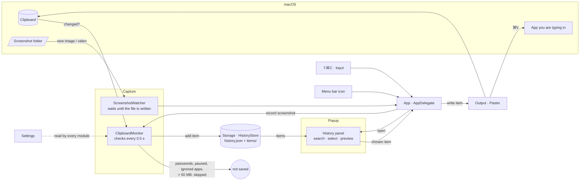
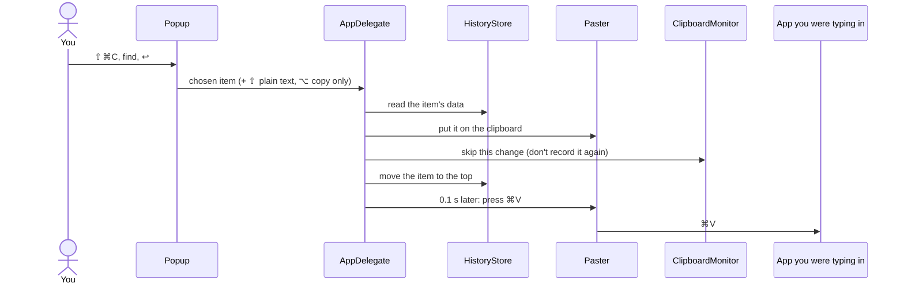

# Pasty

A menu bar clipboard manager for macOS.
Swift + AppKit + SwiftUI, no external dependencies, macOS 14+.

## Features

- Keeps a history of everything you copy: text (with formatting), images, videos, files.
- **Screenshots & screen recordings** (⇧⌘3, ⇧⌘4, ⇧⌘5) land in the history automatically, with thumbnails —
  and are copied to the clipboard right away, so you can ⌘V them immediately (both optional).
- Open the history with **⇧⌘C** — at the cursor, screen center, or below the menu bar icon.
- **Configurable global shortcuts** (Settings → Global Shortcuts): open history, paste last item as plain text,
  pause/resume recording, open settings. Any shortcut can be changed or removed.
- Instant search: type several words in any order.
- The selected item is pasted straight into the active app (simulated ⌘V).
- Preview copied images and screenshots at full size: the eye button next to the item, or ⌘Y.
- Delete any item with the trash button next to it, ⌥⌫, or the context menu.
- Pin items (⌘P) — pinned items stay on top and survive clearing.
- Copying the same thing again moves it to the top instead of creating a duplicate.
- Passwords from password managers (marked with `org.nspasteboard.ConcealedType`) are never saved;
  you can also ignore specific apps.
- Pause recording, history size limit, launch at login.

## Build & install

```bash
./build.sh            # builds build/Pasty.app
./build.sh --install  # also copies it to /Applications and launches it
```

On first launch macOS asks for **Accessibility** access — it is only needed for automatic
pasting (⌘V). Without it, selecting an item just copies it to the clipboard.

To pick up screenshots it also asks for access to the screenshot folder (the Desktop by default).
Screen recordings are stored as links to the file — if you delete the video, it can no longer be pasted.

> **Keep permissions across rebuilds:** run `scripts/make_cert.sh` once. It creates a local
> self-signed certificate that `build.sh` then signs with. Without it the app is signed ad-hoc,
> macOS treats every rebuild as a new app, and you have to remove the old Pasty entry in
> System Settings → Privacy & Security → Accessibility and enable it again.

## Shortcuts

| Keys | Action |
|---|---|
| ⇧⌘C | Open / close history (configurable) |
| ↑ ↓, ⌃N ⌃P, ⌃J ⌃K | Move selection |
| ⌘↑ ⌘↓, PgUp PgDn | Jump to top/bottom, page |
| ↩ | Paste |
| ⇧↩ | Paste without formatting |
| ⌥↩ | Copy only (no paste) |
| ⌘1 … ⌘9 | Paste one of the first nine items |
| ⌘P | Pin / unpin |
| ⌘Y | Preview image (also the eye button) |
| ⌥⌫ | Delete item |
| ⎋ | Close preview, clear search, then close |
| ⌘, | Settings |

Click the menu bar icon for the history, right-click for the menu (pause, clear, settings, quit).

## How it works

Where data comes from and where it goes:



What happens when you pick an item:



Every box is described in detail — inputs, outputs, side effects, guarantees — in its module's
README (see below).

## How the code is documented

Every module of `Sources/PastyCore` has a `README.md` that describes, member by member, what the
code does — inputs, outputs, side effects (files, clipboard, settings, keystrokes…), their order,
invariants and failure behaviour — so you can read the behaviour instead of the code.
`scripts/check_docs.sh` proves the text matches the code: a SwiftSyntax-based extractor
(`Tools/pasty-docs`) pulls the facts out of the code and the check fails on any difference; every
invariant is backed by a test. Start with [docs/ARCHITECTURE.md](docs/ARCHITECTURE.md); the format
is in [docs/DOC_FORMAT.md](docs/DOC_FORMAT.md).

| Module | Purpose |
|---|---|
| [App](Sources/PastyCore/App/README.md) | Startup, menu bar icon, global shortcut actions, pasting a chosen item, screenshots |
| [Capture](Sources/PastyCore/Capture/README.md) | Clipboard polling, screenshot folder watching, classification |
| [Storage](Sources/PastyCore/Storage/README.md) | The history in memory and on disk (`~/Library/Application Support/Pasty`) |
| [Popup](Sources/PastyCore/Popup/README.md) | The searchable history panel and the image preview |
| [Output](Sources/PastyCore/Output/README.md) | Writing to the clipboard, simulated ⌘V |
| [Input](Sources/PastyCore/Input/README.md) | Global hotkeys via Carbon (no permissions required) |
| [Settings](Sources/PastyCore/Settings/README.md) | Preferences and the Settings window |
| [Support](Sources/PastyCore/Support/README.md) | Low-level helpers |

## Development

```bash
swift test                    # tests
scripts/check_docs.sh         # module READMEs vs code (--fix regenerates the module graph)
```

CI runs the build, the tests and the docs check on every pull request.
