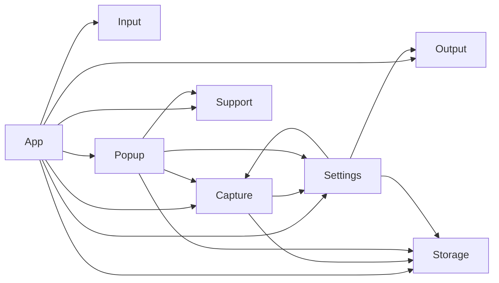

# Pasty architecture

Pasty is a menu bar clipboard manager. The app is the `Pasty` executable — one line that calls
`PastyApp.run()` — on top of the `PastyCore` library, which holds all the logic in eight modules.
Each module is a folder with a `README.md` that describes, member by member, what the code does:
inputs, outputs, side effects, their order, invariants and failure behaviour. Read those instead
of the code; `scripts/check_docs.sh` proves they match it (see [DOC_FORMAT.md](DOC_FORMAT.md)).

## Modules

| Module | What it does | README |
|---|---|---|
| App | Starts the app; menu bar icon, global shortcut actions, "use this item", screenshots, popup lifetime | [App](../Sources/PastyCore/App/README.md) |
| Capture | Notices new clipboard contents and new screenshots, classifies them | [Capture](../Sources/PastyCore/Capture/README.md) |
| Storage | The history: items in memory, data and thumbnails on disk | [Storage](../Sources/PastyCore/Storage/README.md) |
| Popup | The searchable history panel and the image preview | [Popup](../Sources/PastyCore/Popup/README.md) |
| Output | Writes to the clipboard, simulates ⌘V | [Output](../Sources/PastyCore/Output/README.md) |
| Input | Global keyboard shortcuts | [Input](../Sources/PastyCore/Input/README.md) |
| Settings | Preferences and the Settings window | [Settings](../Sources/PastyCore/Settings/README.md) |
| Support | Low-level helpers shared by other modules | [Support](../Sources/PastyCore/Support/README.md) |

## Main flows

**Copy → history.** Every 0.5 s `ClipboardMonitor.check()` compares the pasteboard's change
counter; on a change it reads all data types, skips concealed/transient content, paused state and
ignored apps, classifies the content (`record`) and calls `HistoryStore.add`, which writes the data
to `items/<id>.plist` and saves `history.json` 0.5 s later.

**Screenshot → history.** `ScreenshotWatcher` watches the screenshot folder; once a new file's
size stops changing it calls `AppDelegate.recordScreenCapture`, which optionally puts it on the
clipboard and records it through the same `ClipboardMonitor.record`.

**History → paste.** ⇧⌘C (`HotKey`) or the menu bar icon opens the popup without activating
Pasty. Choosing an item calls `AppDelegate.use`: `Paster.write` puts it on the clipboard,
`ClipboardMonitor.skipCurrentChange` prevents re-recording it, `HistoryStore.touch` moves it to the
top, and 0.1 s later `Paster.paste` sends ⌘V to the app the user was typing in.

**Settings → behaviour.** Modules read `Prefs` when they need a value. Changes that need action
are announced by notifications: shortcuts are re-registered, the screenshot watcher restarts.

## Module graph

Generated from the code by `scripts/check_docs.sh --fix`; the check fails if it is out of date.
An arrow means "calls or reads something in". Shared data types (`ClipItem`, `KeyCombo`) don't
count. Capture ↔ Settings is a real cycle: Capture reads settings, and the Settings window shows
the watched screenshot folder.

<!-- BEGIN GENERATED: module-graph (pasty-docs graph --write) -->

| From | To | What it uses |
|---|---|---|
| App | Capture | `ClipboardMonitor.init(store:pasteboard:)`, `ClipboardMonitor.record(contents:fileURLs:string:imageData:appBundleID:)`, `ClipboardMonitor.skipCurrentChange()`, `ClipboardMonitor.start()`, `MediaFile.kind(of:)`, `ScreenshotWatcher.init()`, `ScreenshotWatcher.onCapture`, `ScreenshotWatcher.restart()` |
| App | Input | `HotKey.init(combo:handler:)` |
| App | Output | `Paster.paste()`, `Paster.write(_:item:plainText:to:)`, `Paster.write(_:to:)` |
| App | Popup | `PopupController.hide()`, `PopupController.init(store:)`, `PopupController.isVisible`, `PopupController.onHide`, `PopupController.onOpenSettings`, `PopupController.onSelect`, `PopupController.show(anchor:)`, `PopupController.tearDown()`, `PopupController.toggle(anchor:)` |
| App | Settings | `Prefs.copyScreenshotsToClipboard`, `Prefs.historyLimit`, `Prefs.hotKey(for:)`, `Prefs.paused`, `Prefs.popupPosition`, `Prefs.registerDefaults()` |
| App | Storage | `HistoryStore.clear(keepPinned:)`, `HistoryStore.contents(for:)`, `HistoryStore.defaultDirectory`, `HistoryStore.init(directory:historyLimit:)`, `HistoryStore.items`, `HistoryStore.purgeCaches()`, `HistoryStore.remove(_:)`, `HistoryStore.saveNow()`, `HistoryStore.touch(_:)` |
| App | Support | `Memory.relieve()` |
| Capture | Settings | `Prefs.ignoredApps`, `Prefs.paused`, `Prefs.saveImages`, `Prefs.screenshotFolder`, `Prefs.watchScreenshots` |
| Capture | Storage | `HistoryStore.add(kind:text:hash:contents:appBundleID:thumbnail:filePath:)`, `HistoryStore.hash(_:)`, `HistoryStore.updateMedia(id:thumbnail:text:)` |
| Popup | Capture | `MediaFile.videoSize(url:)` |
| Popup | Settings | `Prefs.pasteAutomatically`, `Prefs.pastePlainByDefault` |
| Popup | Storage | `HistoryStore.clear(keepPinned:)`, `HistoryStore.fullImage(for:)`, `HistoryStore.isMediaAvailable(for:)`, `HistoryStore.items`, `HistoryStore.remove(_:)`, `HistoryStore.thumbnail(for:)`, `HistoryStore.togglePin(_:)`, `HistoryStore.totalBytes`, `HistoryStore.usage` |
| Popup | Support | `Memory.relieve()` |
| Settings | Capture | `ScreenshotWatcher.folder` |
| Settings | Output | `Paster.hasAccessibility`, `Paster.openAccessibilitySettings()`, `Paster.requestAccessibility()` |
| Settings | Storage | `HistoryStore.clear(keepPinned:)`, `HistoryStore.items`, `HistoryStore.trim()` |

<!-- END GENERATED: module-graph -->

## Why the README files can be trusted

The READMEs are written by whoever changes the code — often an LLM — so they could describe what
was *meant* instead of what was *done*. Three layers keep them honest:

1. **Facts from code, no guessing.** `Tools/pasty-docs` parses `Sources/PastyCore` with
   SwiftSyntax and lists, for every member: its side effects (by category, with the API and line),
   whether their failures are swallowed or caught, the members of other components it uses, the
   callbacks it stores, and the module graph. `scripts/check_docs.sh --facts` prints them.
2. **Text checked against facts.** `scripts/check_docs.sh` fails when a member, type or module is
   undocumented or documented but missing, when the side effects, uses, callbacks or dependencies
   in the text differ from the code in either direction, when a swallowed failure is not explained,
   or when the documented order of effects contradicts the code.
3. **Invariants proven by tests.** Every `INV-<Module>-<n>` in a README must be named by a test in
   `Tests/PastyCoreTests`, and every ID a test names must exist.

What remains a human's job: the meaning of each sentence, values that only exist at runtime, and
macOS behaviour. See "What the check cannot prove" in [DOC_FORMAT.md](DOC_FORMAT.md).
